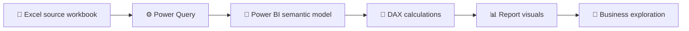

  

# ☕ Coffee Shop Sales Dashboard

### 📊 Interactive retail sales analysis with Microsoft Power BI

**A Power BI portfolio project for exploring coffee shop sales performance, time-based demand, store comparisons, and product-level trends.**

[Project files](#-project-files) · [Documentation](docs/README.md) · [Setup](docs/getting-started.md) · [Data dictionary](docs/data-dictionary.md) · [Contributing](CONTRIBUTING.md)

---

## ☕ Project at a glance

This repository contains a Power BI report, an Excel workbook used as its source-data artifact, and a background image asset. The analysis described by the project focuses on sales, orders, quantity sold, location, product category, time patterns, and top products.

The report is intended to help a coffee shop operator explore questions such as:

- 📈 How do sales, order volume, and quantity sold change month over month?
- 🏪 How do store locations compare?
- 🧋 Which product categories contribute to sales?
- 📅 How do weekdays and weekends differ?
- 🕒 Which day-and-hour combinations show stronger demand?
- ⭐ Which products appear among the top ten by the selected sales measure?

> **Evidence note:** The repository exposes the PBIX and XLSX as binary assets. Exact Power BI table names, field names, DAX expressions, page names, relationship cardinalities, refresh configuration, and visual formatting have not been independently extracted in this documentation pass. Unverified implementation details are identified as such rather than guessed.

## 🧭 Contents

- [Features and analytical views](#-features-and-analytical-views)
- [KPI catalogue](#-kpi-catalogue)
- [Technology and workflow](#-technology-and-workflow)
- [Project files](#-project-files)
- [Quick start](#-quick-start)
- [Using the report](#-using-the-report)
- [Data and model documentation](#-data-and-model-documentation)
- [Architecture](#-architecture)
- [Quality, security, and limitations](#-quality-security-and-limitations)
- [Documentation map](#-documentation-map)
- [Roadmap](#-roadmap)
- [License and contribution](#-license-and-contribution)

## 📈 Features and analytical views

The following capabilities are described in the project overview already present in this repository.

| Analytical area | Business question | Described analysis |
|---|---|---|
| Monthly performance | How is the business changing month to month? | Sales, orders, quantity, MoM percentage and absolute variance |
| Daily sales | Which dates perform above or below average? | Daily sales trend with average reference |
| Store comparison | How do locations compare? | Store-location sales analysis |
| Category mix | Which product categories contribute to sales? | Category-level sales breakdown |
| Product ranking | Which products lead? | Top 10 product ranking |
| Week pattern | Does demand differ on weekends? | Weekday versus weekend comparison |
| Day-hour demand | When does demand concentrate? | Day-and-hour matrix for sales, orders, and quantity |

### 🧮 KPI catalogue

| KPI | Meaning | Interpretation guidance |
|---|---|---|
| Total Sales | Sum of sales value in the selected filter context | Review alongside order count and quantity |
| Total Orders | Number of orders under the model's order-count definition | Confirm row count versus distinct order IDs |
| Total Quantity Sold | Sum of units/items represented by the data | Interpret with product mix and order volume |
| Month-over-Month change | Current month compared with previous month | Confirm date context and missing-month behavior |
| MoM percentage | Relative change from the previous month | A zero or missing prior period needs explicit handling |
| Daily average sales | Average sales per day under the selected context | Confirm whether zero-sale dates are included |
| Top 10 products | Product ranking under a selected measure | Confirm ranking measure and tie behavior |

Exact formulas are intentionally not asserted until the DAX model is inspected.

## 🛠️ Technology and workflow

| Technology | Role |
|---|---|
| Microsoft Power BI Desktop | Report authoring, semantic model, and interactive visualization |
| Power Query | Data import and transformation workflow named by the project |
| DAX | KPI and analytical calculations named by the project |
| Microsoft Excel (.xlsx) | Source-data artifact stored in the repository |
| GitHub | Versioned storage for report, workbook, documentation, and automation |

## 📁 Project files

| Path | Purpose |
|---|---|
| `coffee shop sales.pbix` | Power BI report and model artifact |
| `Coffee Shop Sales.xlsx` | Excel source workbook |
| `Background image.png` | Existing visual background |
| `.github/workflows/update-readme.yml` | Existing README timestamp workflow |
| `docs/` | Project, analytics, data, model, operations, and contribution documentation |
| `docs/assets/` | Original diagrams and documentation graphics |
| `docs/templates/` | Reusable project and review templates |
| `scripts/` | Repository documentation validation utilities |

No application source tree, web frontend, backend service, API, or database service is present in the visible repository. This is documented as a Power BI analytics project rather than a full-stack application.

## 🚀 Quick start

### Prerequisites

- Windows with a compatible version of [Power BI Desktop](https://www.microsoft.com/power-platform/products/power-bi/desktop).
- The supplied Excel workbook if you need to inspect or reconnect the data source.

### Open the report

1. Clone or download this repository.
2. Keep the PBIX and Excel workbook in a known local folder.
3. Open `coffee shop sales.pbix` in Power BI Desktop.
4. If Power BI reports a missing or inaccessible source, open **Transform data** and inspect the workbook source step in Power Query.
5. Update the source path to the local `Coffee Shop Sales.xlsx` copy when required.
6. Apply changes, refresh, and review all report pages and filters.
7. Save a working copy before changing the model or visual design.

Detailed instructions: [Getting started](docs/getting-started.md) · [Data refresh](docs/data-refresh.md) · [Troubleshooting](docs/troubleshooting.md).

## 🔎 Using the report

1. Start with sales, order, and quantity KPIs.
2. Record the selected date range and active filters.
3. Compare store locations and product categories in the same filter context.
4. Inspect daily movement and the average reference line.
5. Review top products and day-hour patterns for operational hypotheses.
6. Validate findings before making staffing or inventory decisions.

Exact slicers, drill-through actions, cross-filter settings, tooltip pages, and navigation controls should be confirmed in the PBIX. See [Report usage guide](docs/report-usage.md).

## 🧱 Data and model documentation

The supplied workbook is the declared data artifact. Exact sheet names, table names, headers, data types, row count, date range, null profile, and key constraints require workbook inspection. The PBIX model should be opened to document relationships, calculated columns, measures, and refresh configuration.

- [Data dictionary and profiling checklist](docs/data-dictionary.md)
- [Power Query and ETL workflow](docs/data-preparation.md)
- [Semantic model and relationships](docs/semantic-model.md)
- [DAX measure catalogue](docs/dax-measures.md)
- [Data quality and validation](docs/data-quality.md)

## 🏛️ Architecture

The documented logical workflow is:

This is a logical architecture based on the project overview, not a reverse-engineered diagram of every internal PBIX object. See [Architecture](docs/architecture.md) and [Diagrams](docs/diagrams.md).

## 🔐 Quality, security, and limitations

- Do not commit credentials, private workspace URLs, tenant identifiers, or customer-sensitive data.
- Review the workbook before sharing it publicly.
- Validate source paths and refresh behavior after moving the repository.
- Check KPI definitions before using the report for operational decisions.
- Do not interpret correlation or visual ranking as proof of causation.
- Power BI Service publishing, gateway setup, scheduled refresh, and row-level security are not claimed as configured by the files currently visible.
- No live dashboard URL is advertised because the previous README contained a placeholder, not a verified public report link.

See [Security](SECURITY.md), [Data quality](docs/data-quality.md), and [Limitations](docs/limitations.md).

## 📚 Documentation map

| Guide | Description |
|---|---|
| [Documentation home](docs/README.md) | Index of all project guides |
| [Product overview](docs/product-overview.md) | Goals, audience, scope, and value |
| [Report usage](docs/report-usage.md) | Analytical workflow and interpretation |
| [Architecture](docs/architecture.md) | Data-to-report architecture |
| [Data dictionary](docs/data-dictionary.md) | Workbook profiling and field inventory |
| [Data preparation](docs/data-preparation.md) | Power Query workflow |
| [Semantic model](docs/semantic-model.md) | Model discovery and relationship documentation |
| [DAX measures](docs/dax-measures.md) | KPI definition and validation catalogue |
| [Visual design](docs/visual-design.md) | Layout, chart selection, and accessibility |
| [Data refresh](docs/data-refresh.md) | Source path and refresh guidance |
| [Testing and QA](docs/testing.md) | Report validation checklist |
| [Deployment](docs/deployment.md) | Desktop handoff and optional Service publishing |
| [Troubleshooting](docs/troubleshooting.md) | Common local setup issues |
| [Limitations](docs/limitations.md) | Evidence gaps and boundaries |

## 🗺️ Roadmap

- [ ] Inspect and document the Excel workbook schema and data profile.
- [ ] Extract PBIX page, model, relationship, measure, and visual inventories.
- [ ] Add real report screenshots with useful alt text.
- [ ] Add verified KPI definitions and DAX expressions.
- [ ] Add refresh and source-reconnection walkthrough based on the actual PBIX.
- [ ] Validate the report against documented test cases.
- [ ] Add a verified Power BI Service link only if a public report is intentionally published.

## 🤝 License and contribution

Distributed under the MIT License. See [LICENSE](LICENSE).

Contributions that improve reproducibility, data definitions, accessibility, or report clarity are welcome. Read [CONTRIBUTING.md](CONTRIBUTING.md) and use the issue templates.

**Built with ☕, 📊, and a focus on evidence-based retail analytics.**

[GitHub profile](https://github.com/Brajesh31) · [Open an issue](../../issues)

Last updated: 2026-11-17 23:36 UTC
