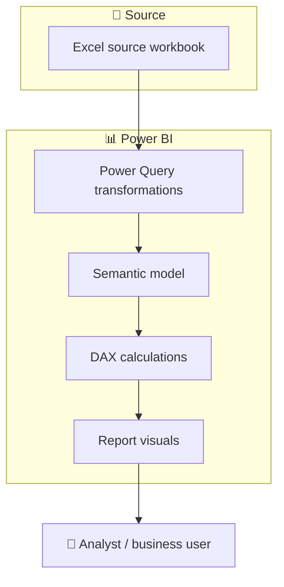
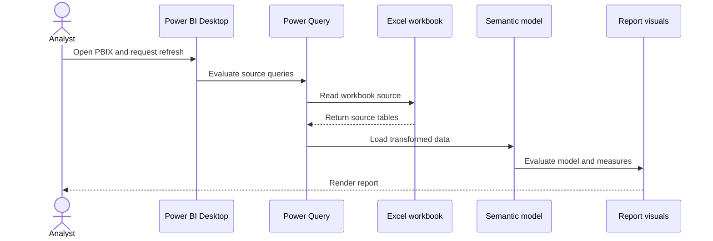

# 🏛️ Architecture Overview

## 🧩 Logical components
The repository describes a Power BI workflow centered on an Excel source workbook:

## 🔎 Component responsibilities
| Component | Responsibility | Evidence status |
|---|---|---|
| Excel workbook | Source-data artifact | File exists in repository |
| Power Query | Data import and transformation | Named by README; exact steps uninspected |
| Semantic model | Tables and relationships | PBIX exists; model uninspected |
| DAX | KPI calculations | Named by README; formulas uninspected |
| Report visuals | Business-facing charts and matrices | Views described; individual visuals uninspected |
| User | Interacts with report | Intended report usage |

## 🔁 Refresh sequence

This is conceptual. Query count, folding behavior, refresh mode, and storage configuration require inspection.

## 🚫 Not represented
No web server, application API, authentication service, online transaction processing, or external database appears in the visible repository file inventory.
