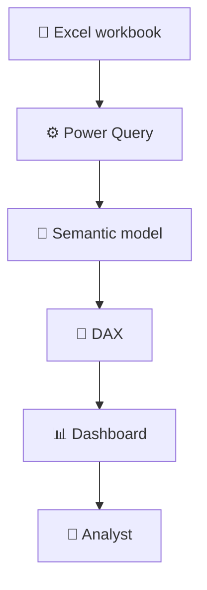
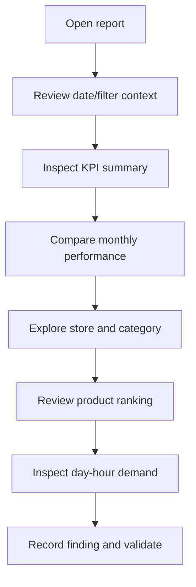
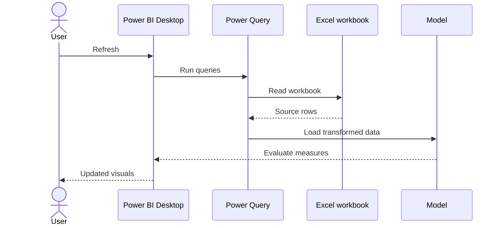
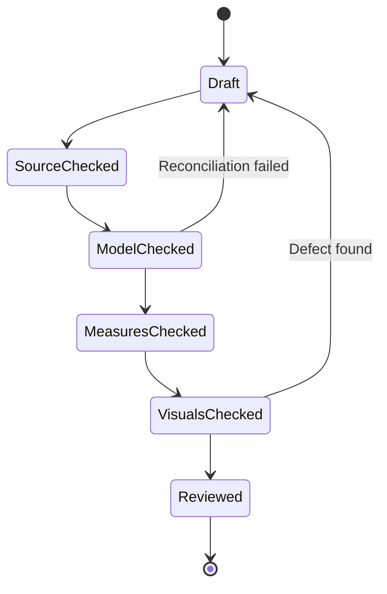

# 🗺️ Diagram Catalogue

The original logical illustrations below are based on the repository's declared Excel → Power Query → Power BI → DAX → report workflow. They are not reverse-engineered PBIX diagrams.

## 1. System architecture

## 2. Analysis workflow

## 3. Refresh sequence

## 4. Report quality state

## 5. Conceptual ER diagram
A verified ER diagram cannot be produced until the workbook and PBIX model are inspected. Do not infer table names, keys, or relationships from the project title. Capture the actual schema in [semantic-model.md](semantic-model.md), then add its Mermaid ER diagram here.
