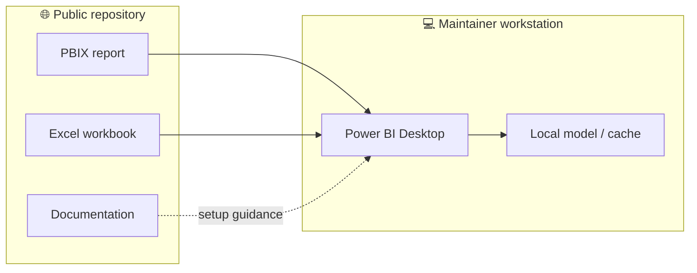

# 🔐 Security Architecture

## Boundary overview
This is a repository-centered Power BI project. The visible artifacts are stored in GitHub and opened locally in Power BI Desktop.

This is a basic local workflow, not a full security design for an unverified Power BI Service deployment.

## Assets to protect
- Source workbook and commercially sensitive records.
- Power BI report and embedded model content.
- Workspace identifiers and sharing links.
- Credentials, tokens, and source connection details.
- GitHub write credentials used by automation.

## Controls
- Inspect and classify workbook data before public release.
- Keep credentials outside the repository.
- Limit workflow permissions.
- Review third-party action versions and ownership.
- Use private reporting for vulnerabilities.
- Review sharing access before publishing reports.
